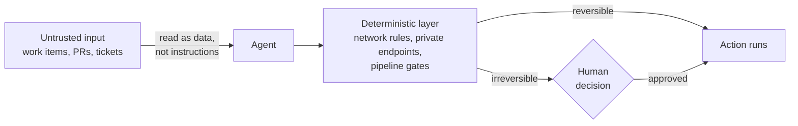

I'm a software architect. Most of my work is reviewing specs and architecture decision records (ADRs), advising teams on platform decisions, and thinking about how large systems hold together over time. I didn't start the Mega.Dev course with specific expectations. AI is moving so fast that it's hard to keep up piecemeal, and I wanted a more structured look at where things stand today. Week 1 delivered that, and something more useful too: a working model of how these systems behave, and of where the deterministic boundaries need to be.

This is the first post in a short series I'm writing while I take the course.

## Non-determinism is the starting assumption

The first lesson covered mechanics. A language model predicts one token at a time and can't take a token back once it has chosen it. The course showed how spread out the model's confidence can be across candidate tokens, even for a simple opening word. In one demo, a model asked for a random number picked 7, wrongly called it even, and couldn't correct itself. The demo used an older model, but the lesson holds: an early poor choice shapes everything after it.

The course is direct about the consequences. Setting temperature to zero makes the model pick the most probable tokens, but it still doesn't guarantee the same output twice. For an architect used to deterministic systems, that's the uncomfortable part. You can't assume anything in an agent's answer is right until you've measured it. The course's advice is to raise the odds of the result you want rather than chase certainty. In practice, that means evaluating across many runs instead of trusting one good demo.

## Context is a budget, not a container

The course notes that context windows run from roughly 250k to 1M tokens. As a rule of thumb, though, models perform best when they use less than 30 to 40 percent of that limit. Long threads also lose information. When a conversation gets too long, the harness can compact it, summarizing earlier turns so the thread can keep going. But a summary is lossy, and details get dropped. In one of the course's examples, compacting a coding thread three times silently dropped facts. The practical consequence: a long agent session on a design review may have forgotten a constraint set at the start. Shorter threads, explicit handoff notes, and a clear record of decisions aren't overhead. They're how the system stays correct.

A handoff demo made the fix concrete. One session completed step one of a shopping-cart change and wrote a handoff file describing step two. A second session read only that file and carried on, using about 500 tokens instead of 5,000. The starting context is heavier than it looks, too. A plain "hi" cost about 21,000 tokens, because the system prompt, tool definitions, and project instructions go out with every call. Any guideline for managing context should start from that baseline.

The second lesson made the same point about instructions. A skill or rule in context isn't necessarily one the model follows. The course recommends short skills, each with a single responsibility, and a precise name and description, because those are what the agent reads when it decides whether to load a skill. I've written review-style skills for specs and ADRs, and they're where I plan to test this first.

The same lesson showed how scope creeps when nobody holds the line. A fix of about 15 lines grew to 271 lines as successive review briefs asked the agent to handle more "missed cases."

## Knowledge bases now have two audiences

The third lesson argued that agents are becoming major readers and maintainers of our knowledge. Markdown and HTML are native to them. Tools built for people often make it hard for an agent to read or edit cleanly. The more useful point was about failure. An agent that finds a procedure but never reaches the note explaining why the procedure works that way can give a confident, wrong answer. Better search alone doesn't fix that. Metadata and global context that explains the landscape do. ADRs are a natural place to start. If each one carried status, owner, source, and a last-reviewed date, an agent could judge how far to trust it.

## Harness-agnostic, and priced per task

The fourth lesson was the most practical. Most harnesses now offer the same core features, so switching tools for one feature is rarely worth it. It's more important to keep agents, skills, CLI tools, and MCP servers portable between harnesses. The course described a single repository that manages skills and configuration across many machines. That's the model I'd like to follow for a shared skills repository.

The course also recommends comparing models on cost per task, not price per token. Its illustrative example uses two hypothetical models. Model A costs $0.50 per million tokens but uses 220k tokens per task, so it comes to $0.11 per task. Model B costs $2.00 per million tokens but uses only 40k, so it comes to $0.08. These are example values, not real benchmarks. The point is that the model that looks cheaper can cost more per task. It's worth measuring this on your own work before picking a default model for review tasks.

The same lesson made a point about privacy that matters for any sensitive data. You can't rely on an LLM to keep data private by choosing the right model or tool, because models find workarounds. The boundary has to be deterministic and enforced by infrastructure, not by a prompt. That means things like private endpoints and network rules, not instructions asking an agent to behave.

## Workflows, security, and subtraction

The fifth lesson connected all of this to delivery. We can now build faster than we can keep up with, so complexity and technical debt grow faster too. The course's answer is to turn repeated work into saved scripts, generalized tools, and single-purpose skills, and to have agents verify outcomes by using the application, not only by passing unit tests.

The course's live demo was modest: a tightly limited, bash-only agent fixed the bugs in a shopping-cart module and passed the tests. Its background-workflow example was more striking. A nightly workflow triages a large volume of pull requests, with a smaller model auditing and stronger models verifying, and returns a handful that are ready to merge. GitHub's rate limits were hit more often than the agents' own limits, which is worth knowing before designing anything similar.

On security, the course draws a useful line. Prompt injection targets which instructions the system trusts. Jailbreaking targets what the model is allowed to do. Work items, PR descriptions, and external tickets are untrusted input, and an agent shouldn't treat them as instructions. Defenses have to be layered, and irreversible actions need a human decision.

The principle the course keeps coming back to is to hack away the unessential. Simplifying and removing should take priority over adding.

## What I want to try

- Add a non-determinism and evaluation requirement to architecture reviews of agentic features.
- Measure cost per completed task for two models on one real spec review.
- Pilot a background dependency-review workflow on a single repository, with existing CI pipeline gates kept as the deterministic layer.
- Write down the irreversible actions an agent may never take without human approval.

I haven't tested any of this yet. Several of the course's figures are illustrative, and I expect some of its examples won't map cleanly to every team's tooling. For me, the value of Week 1 wasn't a set of tools. It was a clearer sense of what to be skeptical about, what to measure, and where the deterministic boundaries belong. I'll share what I learn in a later post once the first experiment has run.

*Course material referenced: the Mega.Dev course, Week 1 (lessons 1–5). Opinions are my own.*
