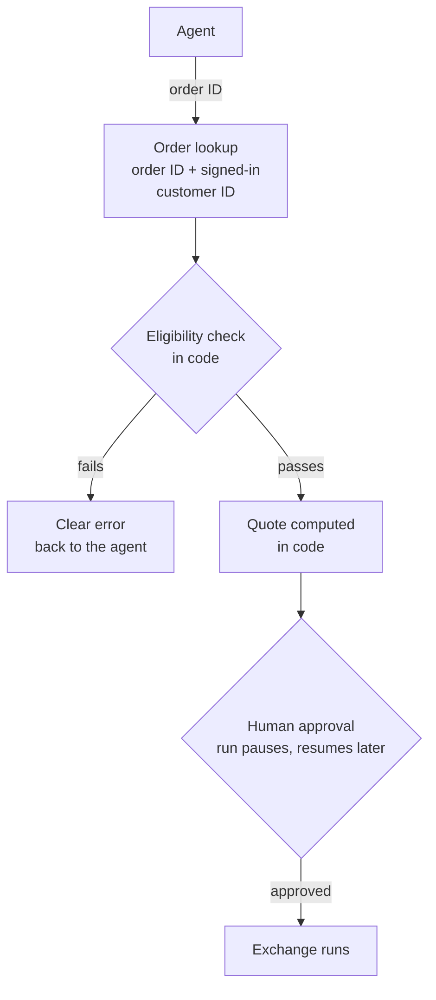
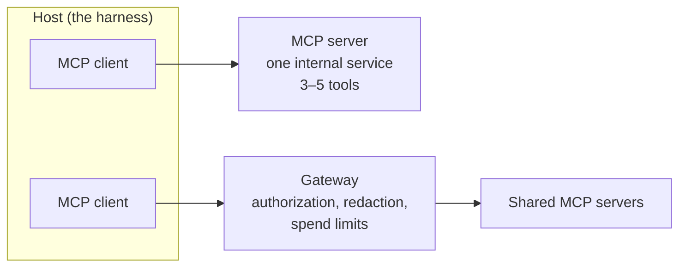

[Week 1]() of the Mega.Dev course was about using agents well. Week 2 moved to building them. It covered the decisions an architect has to make once agents run inside a product, a team, or a platform, and most of it applies directly to the platform and spec decisions we make every week.

This is the second post in a short series I'm writing while I take the course.

## The loop is the easy part

The course defines an agent as a loop. The model returns either tool calls or final text. Tool results go back into the context, and the loop ends when the model stops calling tools. That loop takes a few lines of code, and it isn't enough for real work. A production harness also has to handle provider adapters, sessions, persistence, configuration, context management, and approvals.

Two details stood out. Prompt caching is prefix-based, so the savings last only while the stable front part of the context stays unchanged. And approvals are a first-class state. A person may take days to approve an action, so a run has to be resumable rather than holding a process open while it waits.

## Real limits belong in code

The course is clear that a boundary written in a prompt is only a recommendation, because the model may ignore it. Its retail demo showed the alternative. The order lookup tool requires both the order ID and the current customer's ID, so the tool enforces access, not the model. Exchange eligibility is a pass/fail check in code: the item was delivered within the last 30 days, it isn't a final-sale item, and it hasn't already been exchanged. The quote is computed in code too. That matches how I already think about authorization.

## Tools that tell the truth

Some APIs return a success status even when the action failed, so the agent believes it worked. Others need a multi-step flow. Changing a price in a typical payment API, for example, means creating a new price and then deactivating the old one. A model may know that flow for a well-known public API, but it can't know it for an internal API it has never seen.

For our own platform, that points to a concrete review. Which internal APIs would we expose to agents? Do they report failure honestly? Are their multi-step flows documented in a form an agent can use? Agent-facing tools need clear names, self-contained descriptions, schemas, and errors that say what went wrong and what to do next.

## MCP: start lean

The course describes the Model Context Protocol (MCP) in three parts. The host is the harness. It runs one client per server, and each server exposes tools and resources. For shared tools at scale, the course points to a gateway in front of those servers that handles authorization and redaction.

The course also compared two ways for a model to use tools. With **direct tool calls**, the model calls each tool one at a time and reads every result back into its context. With **code mode**, the model writes one short program that calls the tools, and only the program's final output comes back. In the demo, the task was to search well over a thousand product combinations and return the three cheapest. Compared with direct tool calls, code mode used a small fraction of the tokens, finished in about a quarter of the time, and got the right answer in every run.

That's one test, and the course advises trying both approaches on your own task. My takeaway is to start small: one internal service and three to five tools for one workflow.

## Multi-agent means distributed-systems discipline

Multi-agent designs mostly exist to control context, permissions, and concurrency, and errors propagate from one agent to the next. The Agent2Agent (A2A) protocol is a useful reference even if we never adopt it. Each agent publishes a card describing its skills, and a task can pause in an input-required state until someone supplies what's missing. Every message has to carry the context the receiving agent needs, because it doesn't share the sender's memory. None of that is new to anyone who has designed services that talk to each other.

## Reliability: observe, evaluate, guard

You can't debug LLM behavior the way you debug code. The course proposes three practices:

- **Observability** that captures context, latency, and cost for every call.
- **Evals** that are repeatable and scored.
- **Guardrails** that either shift the odds toward the behavior you want or block an action deterministically.

The clearest example was a retail exchange agent. In one case, a customer reported a broken zipper, and the exchange went through without a quality review because the tool reused an earlier proposal. Across repeated runs, that case failed 3 of 3 times before the fix and passed 3 of 3 after.

The course measures this with pass^k, which counts a case as passing only if it succeeds on every one of k trials. That keeps an intermittent failure from hiding behind one good run. It suggests starting with 10 to 20 well-chosen cases and using deterministic graders first.

## Enterprise guidance from the live Q&A

The week ended with a live Q&A with Angie Jones. Her most repeated point was to use deterministic code wherever you can and bring in an LLM only for the steps that need judgment. When choosing between a subagent and a skill, she suggested running evals many times and letting the results decide.

She also said enterprise agent work needs finance, IT or developer experience, and security involved from the start, along with a fast procurement path for AI tools. In her view, AI gateways are a must-have. They check tool calls against policy and enforce spending limits, and she described a single agent looping overnight and spiking the bill as the kind of thing they prevent.

On adoption, she described a small group of champions, around 1 percent of engineers, who added skills and agent instruction files to repositories. Once nearly everyone was using the tools, the team stopped tracking adoption and measured delivery instead. When agents picked up sprint tickets, teams completed roughly three times as much work. Delivery, not adoption, is the metric I'd want us to use.

## What I plan to do next

1. Write 10 eval cases for one agent feature we own, with deterministic graders first, and record a pass^k baseline.
2. Route that agent's model calls through a single traced path, after a data-handling review.
3. Propose approval gates and resumable runs for any irreversible agent action.
4. Audit the internal APIs an agent would call for false-success responses and undocumented multi-step flows.
5. Draft a lean MCP tool proposal for one internal service.

None of this needs a new platform. It means treating agents as systems with contracts, limits, and measurements, which our architecture work already does. I'll share results once the first eval set has run.

*Course material referenced: the Mega.Dev course, Week 2 (lessons 1–5) and the Week 2 live Q&A. Figures are from course demos and are rounded. Opinions and plans are my own.*
