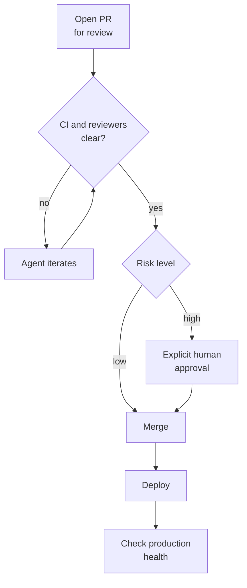

[Week 2]({{ '/architecture/software/ai/mega-dev-week-2/' | relative_url }}) of the Mega.Dev course was about building agents. Week 3 moved to the work around them: how to describe intent, how to prove an outcome, how to limit the damage when a mistake reaches production, and how a product keeps learning after release. I read each part with enterprise architecture in mind. Most of it describes work our review process already does, with the gaps made visible.

This is the third post in a short series I'm writing while I take the course.

## From output to outcome

The course's central shift is from output to outcome. The question is no longer "is the ticket done?" but "can the user now do what they need?" Lines of code and tickets closed are easy to game. Whether the job got done is the better measure.

The course's integration example shows why it matters. A request to connect several sources can grow into a gateway with one adapter per source, and every adapter adds maintenance. A single primitive that handles subscriptions and wake-up events can cover the same sources and stay lean. Both deliver output. Only one keeps the product small enough to change.

## Describe intent with principles and reasons

The course argues that agents work better with principles than with rules. "Match your caution to the cost of being wrong" leaves room for judgment in a way that "never delete files" does not. Giving the reason behind a principle supplies the boundary the agent can't see on its own.

Instead of a detailed specification, the course recommends a short agreement that covers four things: scope, outcome, boundaries and proof.

## Evidence matched to risk

The rule is to match the evidence to the risk and to the kind of change:

- A small fix that **composes** existing parts needs a few checks.
- A change that **extends** or alters existing behavior adds tests and a separate reviewer.
- A **one-way door**, such as a public API, a destructive migration or money movement, adds human approval.

Agents can also generate evidence instead of capturing it, so the evidence has to come from the real build: screenshots, logs, measurements and test output. The course's example workflow runs 33 deterministic checks and keeps them fast with caching.

## Proof in the pull request

The Week 3 material on AI-native development makes this concrete. An agent's pull request includes screenshots or video, a production-like preview environment, and a recap of the affected primitives and user flows.

The course compared three AI reviewers: Cursor Bugbot, CodeRabbit and Devin. The speaker preferred Cursor Bugbot overall and found Devin especially useful for security findings. Whichever you use, the reviewer should be separate from the agent that wrote the change.

A ship-PR script then runs the merge as a state machine:

That matches the one-way-door rule above. The script can move a low-risk change forward on its own, but a person signs off on the changes we can't easily reverse.

## Containment when a mistake reaches production

**Feature flags** turn one-way doors into two-way doors. In the course's Cody example, a flag for enforcing credential requirements shipped turned off by default, and 211 packages were migrated by hand before the flag was removed. The course suggests every flag carry a success metric, such as a count that should fall after rollout.

**Deploy verification** closes the loop after merge. It checks that the health endpoint reports the merged commit or a later one. If the deploy fails, the agent keeps working the job until the change actually lands.

**Backups** come last. A backup only matters once its restore has been tested, and restore time itself adds to data loss. Restores should run automatically into a non-production environment on a schedule. The cautionary case was an agent that deleted a production volume that also held its backups, with a recovery plan nobody had tested. Cody keeps its recovery dashboard on separate infrastructure behind access control, and a manual, isolated restore drill has already exposed a broken recovery process, which was then fixed.

## The software factory: Author's Day Q&A

The Q&A grouped the work into three pillars:

1. **Build the right thing**, with ADRs and primitives.
2. **Catch wrong builds**, with verification.
3. **Limit the blast radius**, with flags and disaster recovery.

The course team has over 100 ADRs and plans to garden them into a current-state set. ADRs and primitives are worth using at any scale for a long-lived product, and they become essential somewhere past 250,000 to 500,000 lines of code. Product and implementation specs can live in one document, with agents deciding anything they're 80 to 90 percent confident about. As someone who reviews a lot of ADRs, the gardening point is the one I'll take back first: a pile of historical decisions isn't the same as a clear picture of how the system works today.

## Products that learn after release

Signals come from more than logs. Webhooks, scheduled scans and support channels all count. The source has to be trusted, though, because report text is data and can carry prompt injection.

After release, observed signals should be compared with the original agreement. That catches a change that hits its target but doesn't fit the product.

Agents should also file friction in a standard format: what happened, what was wanted, a repro, the cost, the investigation so far and the files involved. A daily sweep then either fixes each item or labels it as needing a decision. Flags are removed after rollout, and telemetry comes before any unclear code is deleted.

## What I plan to do next

1. Add a success metric, scope and rollback owner to each new feature flag and release agreement.
2. Schedule one isolated restore drill for an Azure service we own, and record the restore time and any gaps.
3. Confirm that backups for one production database are stored outside the resource they protect, and document where.
4. Adopt the three-level evidence table (composes, extends, one-way door) for one team, with an acceptance summary and a high-risk approval rule in agent pull requests.
5. Start a friction log with a daily sweep for one engineering team, and add telemetry before removing any unclear code path.

None of this needs a new platform. I'll share results from the first restore drill once it has run.

*Course material referenced: the Mega.Dev course, Week 3 (S03E01 to S03E05) and the Author's Day Q&A. Opinions and plans are my own.*
